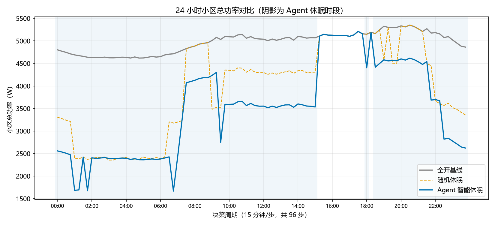
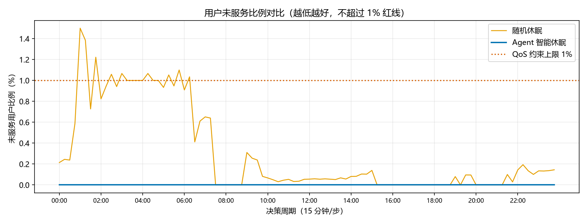
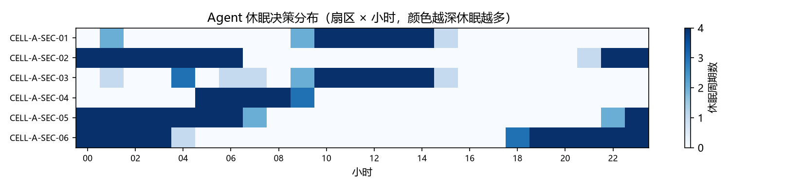

# Network Energy Agent

> **一句话定位**：用 LangGraph 搭一个"敢让运维用"的小区扇区休眠节能 Agent —— 决策全由确定性代码完成、每一条都算得清；大模型只负责把结果讲成人话，绝不参与数值判定。

[](https://www.python.org/)
[](https://github.com/langchain-ai/langgraph)
[](LICENSE)
[]()

**开源仓库**：<https://github.com/zhouhengchang/network-energy-agent>

> ⚠️ **安全边界（先看这条）**：本项目**不控制任何真实基站硬件**。仅使用只读负载数据 + 模拟决策记录，所有"休眠指令"只写入本地文件与日志，**绝不下发至真实设备**，仓库内不存在任何网元写通道。

---

## 这个项目解决什么问题

基站扇区约 60%~70% 的功耗是与话务无关的**静态开销**。凌晨 3 点扇区里只有 3 个用户，功耗依旧接近峰值的 70%。

休眠能省电，但运维不敢随便睡：话务一突增就是接入失败、切换掉线。

所以本项目的核心不是"能不能自动睡"，而是**"睡了之后敢不敢负责"**：

| 维度 | 本项目做法 |
|---|---|
| 数值决策 | 确定性算法（组合枚举 + 加权多目标），无随机、无训练 |
| LLM 角色 | 只把决策结果翻译成中文解释，**不参与任何数值** |
| QoS 保障 | 未服务比例超 1% 直接放弃休眠；独立复核 + 突发回滚 |
| 可审计 | 每 15 min 一条决策记录，含完整算式，可逐条复算 |

---

## 整体架构

```
                  ┌──────────────────────────────────────┐
                  │  L1 数据源                            │
                  │  纯 NumPy 合成流量 / 试验网只读 KPI    │
                  └────────────────┬─────────────────────┘
                                   │ 每 15 min 一次快照
                                   ▼
                  ┌──────────────────────────────────────┐
                  │  L2 工具层（3 个纯函数）               │
                  │  get_sector_state()                  │
                  │  estimate_energy_saving()            │
                  │  estimate_qos_impact()               │
                  └────────────────┬─────────────────────┘
                                   ▼
   ┌───────────────────────────────────────────────────────────────┐
   │  L3 LangGraph 决策图（确定性，无 LLM）                          │
   │                                                               │
   │  ① read_state ──► ② filter_candidates ──► ③ score_combinations│
   │                                                    │          │
   │                            ④ select_best ◄──────────┘          │
   │                                    │                          │
   │                            ⑤ qos_check                        │
   │                          ┌─────────┴─────────┐                │
   │                   通过   │                   │  越界           │
   │                          ▼                   ▼                │
   │                  ⑥a apply_decision    ⑥b abort_all_on         │
   │                          └─────────┬─────────┘                │
   │                                    ▼                          │
   │                        ⑦ audit_and_rollback（突发回滚）        │
   └────────────────────────────────────┬──────────────────────────┘
                                        ▼
                  ┌──────────────────────────────────────┐
                  │  L4 解释层（唯一用 LLM 的地方）        │
                  │  Ollama 本地小模型 → 中文决策理由      │
                  │  失败自动降级为规则模板               │
                  └────────────────┬─────────────────────┘
                                   ▼
                  ┌──────────────────────────────────────┐
                  │  L5 输出：决策记录 CSV / 对比图表 /    │
                  │      审计日志（只落地，不下发）        │
                  └──────────────────────────────────────┘
```

**关键分界**：L3 之上（含 L3）全是确定性代码，L4 只读 L3 的结果、只输出文字。把 L4 整个删掉，调度结果一个字节都不会变。

---

## 快速开始

### 环境要求

- Python ≥ 3.11（开发环境 3.13）
- 可选：Ollama（用于生成决策解释；不装也能跑，会自动用模板解释）
- 不需要 GPU

### 一键运行

```bash
# 1. 安装依赖
python -m venv .venv
# Windows: .venv\Scripts\activate
# Linux/macOS: source .venv/bin/activate
pip install -r requirements.txt

# 2. 生成 24 小时合成流量（96 个决策周期，6 扇区）
python sim/traffic_generator.py

# 3. 跑两条基线（全开 / 随机休眠）
python sim/baseline_runner.py

# 4. 跑 Agent 智能休眠（--explain-mode never 可跳过 LLM，最快）
python graph.py --explain-mode on_change

# 5. 生成三策略对比表 + 图表
python sim/compare_and_plot.py
```

结果全部输出到 `sim/result/`。

### 只想快速验证决策逻辑（不装 Ollama）

```bash
python graph.py --no-llm
```

### 7 天数据（对应验证计划）

```bash
python sim/traffic_generator.py --days 7 --out sim/result/sector_traffic_7d.csv
python graph.py --csv sim/result/sector_traffic_7d.csv --out sim/result/agent_result_7d.csv --no-llm
```

---

## 目录结构

```
network-energy-agent/
├── README.md                 # 本项目说明
├── graph.py                  # LangGraph Agent 主逻辑（7 节点 + 条件边）
├── requirements.txt          # 依赖清单
├── LICENSE                   # Apache-2.0
├── tools/
│   ├── constants.py          # 功耗 / QoS 模型参数（全部为仿真假设值）
│   ├── sector_state.py       # 工具1：扇区状态只读读取
│   ├── energy_estimator.py   # 工具2：节能收益量化
│   └── qos_estimator.py      # 工具3：QoS 影响评估
├── sim/
│   ├── traffic_generator.py  # 合成流量生成（纯 NumPy 兜底方案）
│   ├── baseline_runner.py    # 基线策略：全开 / 随机休眠
│   ├── qellaris_fallback.py  # 第三方仿真包适配与兜底层
│   ├── compare_and_plot.py   # 三策略对比 + 图表导出
│   └── result/               # 基线 + Agent 对比结果（CSV / PNG）
└── docs/
    ├── project-description.md
    ├── technical-proposal.md
    ├── validation-plan.md
    └── submission-checklist.md
```

---

## 核心算法（三行说清）

```python
# 对每个候选休眠组合 c：
score(c) = w_e * ΔE(c) - w_q * U_unserved(c) - w_s * S(c)

# 硬约束（不满足直接淘汰，不参与打分）：
unserved_ratio(c) ≤ 1%           # 用户服务阈值
E_plan(c) ≤ E_baseline * 0.9     # 本周期节能目标
```

- `ΔE`：该组合休眠一个周期省下的电量（kWh）
- `U_unserved`：该组合导致无法接入的用户数
- `S`：与上一轮配置相比需要切换的扇区数（抑制休眠/唤醒反复横跳）
- `w_e = 1.0`，`w_q = 0.8`，`w_s = 0.08`：把"用户体验"和"切换成本"折算成可比的能量代价

MVP 场景 6 个候选扇区 = 64 种组合，全量枚举，单周期 < 5 ms。候选超过 12 个时自动切贪心。

细节见 [`docs/technical-proposal.md`](docs/technical-proposal.md)。

---

## 仿真对照结果

单小区 6 扇区、24 小时、96 个决策周期，合成流量（固定种子，可复现），本地 CPU 运行：

| 策略 | 总能耗 (kWh) | 节能率 | 加权未服务率 | 峰值未服务率 | 休眠扇区·周期 |
|---|---|---|---|---|---|
| 全开基线 | 119.254 | — | 0.0000% | 0.000% | 0 |
| 随机休眠（不校验 QoS） | 94.637 | 20.64% | 0.1146% | **1.500%** | 131 |
| **Agent 智能休眠** | **84.407** | **29.22%** | **0.1462%** | **1.000%** | 186 |

**三句话读懂这张表**：

1. Agent 比"什么都不做"省 **29%** 的电，比"随机瞎睡"多省 **10.19 kWh/日**；
2. 随机策略的峰值未服务率达到 **1.5%**，已经**越过了 1% 的 QoS 红线**；Agent 的峰值恰好压在 **1.0%**，96 个周期全部合规 —— 这就是"有硬约束"和"没有"的差别；
3. Agent 的加权未服务率反而比随机略高，因为它会**主动把体验余量兑换成节电量**（`w_e=1.0 > w_q=0.8`），但从不越线。把 `w_q` 调高就会变保守。







> 完整的数据说明与指标口径见 [`sim/result/README.md`](sim/result/README.md)。
> 再次强调：以上均为**合成数据 + 简化功耗模型**的结果，用于验证决策链路正确性，**不代表真实现网的节能幅度**。

---

## Pre6G 试验网申报进展

| 阶段 | 状态 | 说明 |
|---|---|---|
| MVP 仿真环境 | ✅ 完成 | 本地 CPU 可运行，纯 NumPy 数据源 |
| LangGraph Agent | ✅ 完成 | 7 节点确定性决策图 + QoS 校验 + 回滚 |
| 三份申报文档 | ✅ 完成 | 项目描述 / 技术方案 / 验证计划 |
| 材料清单 | ✅ 完成 | `docs/submission-checklist.md` |
| 开源仓库 | 🟡 待发布 | 本地已就绪，待推送 GitHub |
| 开发者实名认证 | ⬜ 待办理 | 需开发者本人材料 |
| 试验网接入申请 | ⬜ 待提交 | 只读 KPI 接口 + 模拟决策日志接口 |

**申报边界（贯穿全部材料）**：

- 只读负载数据 + 模拟执行，**不控制真实基站**
- 全部运算在本地 CPU 完成，**无需云端大模型集群**
- 仅使用合成数据，**不接入运营商现网**

---

## 技术选型说明

**为什么不用强化学习？** 因为要过运维审核。RL 的决策不可解释、训练不稳定、冷启动有风险，而试验网阶段最需要的是"能被逐条复算的对照数据"。

**为什么还要用 LLM？** 因为运维值班人员不读打分表。"03:15 休眠 SEC-01/05，因为负载 3.1%、用户 3 人、邻区余量充足、预计未服务 0.6%"这句话，比一行 `score=0.597` 有用得多。LLM 在这里做的是**沟通**，不是**决策**。

**为什么加独立复核？** 防自己。万一枚举环节有 bug 把不可行解当成了可行解，⑤ 号节点重算一次仍能拦住。多花不到 1 ms，换"任何情况下都不会因上游 bug 牺牲用户"。

---

## 后续迭代计划

### 1. 多小区多 Agent 协同（近期）

当前只考虑单小区内 6 个扇区互相吸收用户。真实网络中，邻区可能属于**不同小区**，跨小区协同才能准确刻画吸收能力。

计划：每个小区一个 Agent，通过共享的"邻区负载摘要"做轻量协商，避免多个 Agent 同时休眠相邻扇区导致覆盖空洞叠加。

### 2. 接入语义通信流量场景（中期）

Pre6G 强调通感算智融合，语义通信将成为重要业务形态。语义业务的特点是**对丢包/时延的容忍度与普通数据业务不同**——一段语义特征丢失可能导致整帧语义失效。

计划：在 QoS 模型里引入"语义重要性权重"，使 URLLC / 语义业务用户禁止迁移，普通数据业务用户优先迁移。

### 3. 多级节能状态（中期）

当前只有"开 / 深休眠"两态。真实设备支持符号关断、通道关断、载波关断等多级状态，节能粒度更细。

计划：把动作空间扩展为多级，打分函数不变，只是候选集合变大（仍受 `MAX_COMBINATION_ENUM` 保护，超出自动贪心）。

### 4. 真实 KPI 校准（试验网阶段）

用试验网 7 天只读数据反向校准 `HOLE_RATE`、`RESIDUAL_MARGIN` 等模型参数，把"估算的未服务率"逐步逼近"实测掉线率"。

### 5. 接入实时流式数据（远期）

从"离线回放 CSV"升级为"在线消费 KPI 流"，决策周期内完成采集-计算-记录闭环。仍保持只读 + 只记录的安全边界。

---

## 常见问题

**Q：真的完全不会碰真实基站吗？**
A：代码层面没有任何写通道 —— 没有 `POST/PUT/PATCH`，没有 SNMP Set，没有 NETCONF edit-config，没有 SSH，没有网元 SDK 依赖。休眠结果写进 CSV 和日志文件。

**Q：LLM 会不会偷偷影响决策？**
A：`explain` 节点的返回值只写 `scratch.last_record.explanation`，不触碰 `sector_states` / `energy_budget` / `decision_history` 的任何数值字段。审计记录里的 `explanation_source` 字段会标明这条解释来自 `ollama` 还是 `template`。

**Q：没有 Ollama 能跑吗？**
A：能。`python graph.py --no-llm`，全程用规则模板生成解释，决策逻辑完全一致。

**Q：为什么合成数据里 6 个扇区负载差这么多？**
A：故意设计的。6 个扇区分别绑定住宅/办公/商业/园区/工业五种人群活动模板，模拟真实小区"忙闲不均"的特征——如果所有扇区曲线一样，休眠优化就退化成简单的时段判断了。

---

## 许可

[Apache License 2.0](LICENSE)

## 免责声明

本项目为**仿真与算法验证性质**的研究代码，输出结果基于合成数据与简化功耗模型，**不代表任何真实网络的实测性能**。未经授权不得用于任何现网设备的实际操作。
